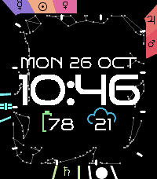
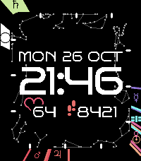
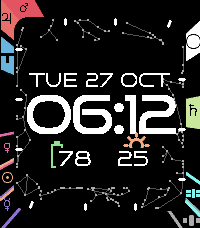

# Nadir

A Pebble Time 2 watchface that shows where the Sun, Moon, planets and space
stations are in your sky right now, around the time, date and two readouts
of your choice.

<p>
  
  
  
</p>

Runs on the Pebble Time 2 (`emery`, 200 x 228, 64 colours). All the sky maths
runs on the watch, so it keeps working with the phone away.

## How to read it

- **Outer ring** is the ecliptic, the Sun's path through the sky, bent into a
  loop with a coloured tab for each body. It is turned so the part of the
  ecliptic that is rising sits at the middle of the left edge and the part
  that is setting at the middle of the right edge. The top half of the screen
  is above your horizon and the bottom half below it; zenith is the top.
- **Which way you face.** From the northern hemisphere you see the planets
  facing south, with east on the left and west on the right. From the
  southern hemisphere you face north, so the whole face is mirrored: east is
  on the right and the constellations are upside down, as they look there.
  The automatic setting follows your location but only changes once you are
  out of the tropics (23.4 degrees from the equator), so travelling near the
  equator does not flip it back and forth. You can also fix it either way.
- **Solid tabs are up.** A body below the horizon keeps only the two sides of
  its tab, with its symbol in its colour.
- **Inner band** carries the twelve zodiac constellations on the same
  mapping, so the whole picture turns once a day. White ticks mark every 30
  degrees of longitude, where one sign hands over to the next.
- **The Moon's tab** is a small disc lit as the Moon is tonight, lit on its
  west side, so it flips with the view as it does in the sky.
- **Satellites** (the ISS in cyan, Tiangong in blue, Hubble in grey) are not
  on the ecliptic, so they are placed by elevation: straight up is the top of
  the ring, the horizon is the middle of either side, and each sits left or
  right by whether it is in the east or west of your sky. While one is more
  than 10 degrees up it moves every 3 seconds instead of once a minute.
- Tabs that would land on top of each other are nudged apart, so a
  conjunction reads as two bodies side by side.
- **Readouts** under the time: two numbers laid over their icons, each one of
  battery, weather, heart rate, steps today or nothing.
- **Flick your wrist** (or tap the watch firmly) and the sky rolls a few hours
  ahead, pauses, then slides back to now. The clock keeps the real time.

## Settings

The gear beside Nadir in the Pebble phone app opens its settings:

- which way the face looks: automatic, facing south (northern hemisphere) or
  facing north (southern hemisphere)
- what each readout shows, and Celsius or Fahrenheit
- which satellites to show: the ISS (on by default), Tiangong and Hubble
  (off by default; Hubble is only seen from within about 30 degrees of the
  equator)
- whether a flick rolls the sky, and by how many hours (1 to 12, default 4)

The watch keeps the choices, so they survive a restart.

## Privacy

Nadir sends your rounded location to Open-Meteo for the weather and nothing
about you anywhere else. Details in [PRIVACY.md](PRIVACY.md).

## Where the numbers come from

The phone side (`src/pkjs/index.js`) only supplies what the watch cannot
know:

| Data | Source | Refreshed |
|---|---|---|
| Location | the phone's location service; falls back to Sydney | every 30 min |
| Satellite orbital elements (TLE) | [CelesTrak](https://celestrak.org): ISS 25544, Tiangong 48274, Hubble 20580 | cached 6 h on the phone; the watch ignores them after 14 days |
| Weather | [Open-Meteo](https://open-meteo.com) (CC BY 4.0), no key | every 30 min |

On the watch (`src/c/astro.c`), planets use JPL's "Approximate Positions of
the Planets" (Table 1), the Moon a short series after Meeus, and satellites a
Kepler orbit with the J2 drift of the node and perigee. Checked against
astronomy-engine and satellite.js (SGP4): the Sun, planets and ascendant to
within 0.1 degree, the Moon 0.03, and satellite elevation and azimuth 0.4.

Constellation lines come from [d3-celestial](https://github.com/ofrohn/d3-celestial).
Regenerate `src/c/sky_data.h` with
`node tools/gen-sky-data.mjs constellations.lines.json`.

## Building

You need the Pebble SDK (4.33.1 or later) with the `emery` platform; see
[developer.repebble.com](https://developer.repebble.com).

```bash
pebble build                          # makes build/nadir.pbw
pebble install --emulator emery       # try it in the emulator
pebble install --phone <phone-ip>     # or on the watch, via the phone app's developer connection
```

The build fetches the settings library (pebble-clay) from npm.

### Building on Windows through WSL

`tools/wsl-build.sh` copies the project into a WSL distro called `pebble`
that has the SDK, builds it there and leaves `nadir.pbw` in the project:

```bash
wsl -d pebble -- bash /mnt/c/path/to/nadir/tools/wsl-build.sh
wsl -d pebble -- bash /mnt/c/path/to/nadir/tools/wsl-build.sh install-emulator
```

To install on the watch from WSL with the phone on USB, run
`node tools/phone-relay.mjs` on Windows (it wakes the Pebble app's developer
connection over adb and relays it to WSL), then
`wsl -d pebble -- bash .../tools/wsl-build.sh install-phone <wsl-host>:9124`,
where `<wsl-host>` is the Windows side of WSL's network (`ip route` in WSL).

## Things worth knowing

- **No libm.** The toolchain's maths library reaches its constant tables
  through absolute addresses, and the Pebble loader only relocates `.data`.
  On the watch, calls like `fmod` crash the face at launch ("not
  responding"); in the emulator they quietly return wrong values. `astro.c`
  has its own `sin`, `cos`, `sqrt`, `remainder` and `atan2`, and no source
  includes `<math.h>`, so a libm call fails the build.
  `arm-none-eabi-nm build/emery/pebble-app.elf | grep -E "sin|cos|sqrt|__ieee754"`
  should find nothing. `strtod` is avoided too: it drags file I/O into the
  link.
- **Test on the watch.** The emulator hides crashes like that one. With the
  phone on adb, `adb logcat | grep AppRunState` should show Nadir's start
  (`16183a4f`) with no stop straight after.
- The emulator washes colours out compared with the real display.
- **Power.** Measured on the watch: the sky maths takes 4 to 8 ms a minute and
  a redraw about 40 ms. Star and tick positions are worked out once per sky
  update, and a pass update moves only the satellites. The touch screen is
  never used, and the tap service and health tracking are only switched on
  when a setting needs them.
- Message keys are declared in `package.json` and appear as `MESSAGE_KEY_*`
  in C. The watch asks the phone for fresh data every 30 minutes.

## Credits and licences

Nadir's own code is under the [MIT licence](LICENSE). It uses Bruno Ace and
Noto Sans Symbols (SIL Open Font License 1.1), d3-celestial's constellation
lines (BSD 3-Clause) and pebble-clay (MIT); weather data is by Open-Meteo.com
(CC BY 4.0). Full notices are in [THIRD_PARTY_NOTICES.md](THIRD_PARTY_NOTICES.md)
and [resources/fonts/LICENSES.md](resources/fonts/LICENSES.md).
